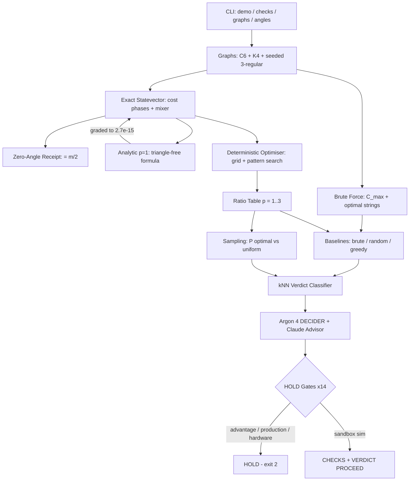
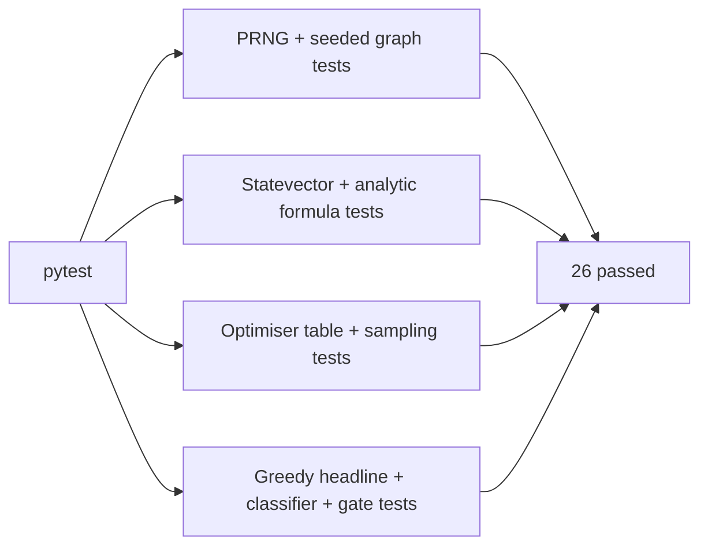
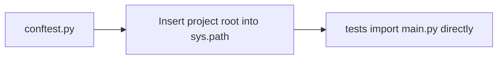
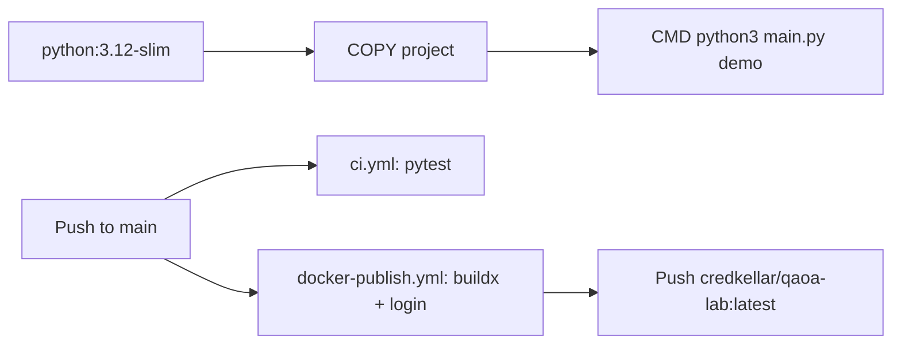

# QAOA-Lab 🎛️⚛️

**Quantum Approximate Optimization Algorithm Lab — MaxCut by Exact Statevector, Graded Against Brute Force and Greedy** — by Darion Kellar

QAOA-Lab is an **educational Quantum Approximate Optimization Algorithm lab** in ONE pure-Python file. It builds the QAOA circuit **from scratch** — the cost unitary `exp(-iγH_C)` as exact diagonal phases `exp(-iγ·cut(x))`, the mixer `exp(-iβΣX)` applied qubit by qubit — and runs the **full statevector** on three graphs small enough to **brute-force the true MaxCut optimum**, so every QAOA number is graded against the truth:

- the **zero-angle receipt**: at γ = β = 0 the prepared state is |+⟩^n and ⟨C⟩ equals the uniform-random expectation m/2, computed two independent ways;
- the **analytic receipt**: on the triangle-free cycle C6, the known p = 1 closed form `⟨C⟩ = m·(½ + ½·sin(4β)·sin γ·cos γ)` matches the statevector to **2.7e-15** over a 20-point angle grid, and peaks at exactly **4.5 (ratio 0.75)** at γ = π/4, β = π/8;
- the **optimisation table**: a deterministic grid + pattern search (no randomness) for p = 1, 2, 3 on all three graphs, ratios non-decreasing in p on these instances, every row beating the uniform-random ratio;
- the **honest headline**: a one-pass classical **greedy reaches the brute-force optimum on all three graphs** — QAOA's expected cut only ties it at p = 3 on C6 and K4 and stays below it (9.361 vs 10) on the seeded graph. QAOA is compared here, never crowned.

Honest scope, stated up front: these are **tiny instances** (4–8 qubits) simulated **classically and exactly**. Beating uniform sampling (up to ×39.5 on optimal-string probability) is a statement about a prepared state versus dice, not about quantum advantage — no advantage, hardware, or production claim is made anywhere, and those uses are permanent HOLD gates (14 total). 🔒

[](https://github.com/kimanicollier44-cmyk/QAOA-Lab/actions/workflows/ci.yml)
[](https://github.com/kimanicollier44-cmyk/QAOA-Lab/actions/workflows/docker-publish.yml)

> ℹ️ These are the **live** workflow badges for this repo. They activate as soon as the `ci.yml` and `docker-publish.yml` files from the paste pack are pasted into `.github/workflows/` — until then they have nothing to report yet.

## 🧰 Tech Stack Badges & Full Architecture Tech Stack

### 💻 Core Programming Languages & Core Systems


- 🐍 Python 3.12, pure standard library (`math`, `cmath`, `hashlib`, `json`, `sys`) — zero dependencies, zero network, deterministic (double-run byte-identical)
- ⚛️ Exact statevector core from scratch: the MaxCut Hamiltonian's eigenvalue on a basis string is its cut size, so the cost unitary is a diagonal phase per string; the mixer is applied as exact 2×2 rotations `(cos β)·I − i·(sin β)·X` per qubit — no approximation anywhere, norm preserved to 1e-12
- 🎯 Analytic referee: the p = 1 triangle-free regular closed form `⟨C⟩ = m·(½ + ½·sin(4β)·sin γ·cos^(d−1) γ)`, graded against the statevector on a 20-point grid (max deviation 2.7e-15) before it is believed
- 🔍 Deterministic optimiser: fixed coarse grid for p = 1, then warm starts (zero-layer append / prepend / angle stretching) plus a coordinate pattern search with a fixed halving step schedule — the same angles on every machine, and the zero-layer warm start is why the reported ratios cannot decrease with p
- 🌱 One seeded instance: the random 3-regular graph on 8 vertices is drawn from an in-file **splitmix64 PRNG, seed 20261119** (named here and in the code) — the only randomness in the lab, and it is a fixed constant in disguise
- 🧠 TinyML kNN verdict classifier (from scratch, stdlib, distance-weighted): optimal-reached / strong / promising / weak / no-better-than-uniform from (approximation ratio, optimal-string factor, depth), labels from the lab's own policy
- 🪑 Council seats: Gemini Argon 4 DECIDER (names-only, tighten-only) + Muse advisor (never overrides HOLD) + Google Flow plan-only (rendered = False, live = 0)

### ⛓️ Web3 & Infrastructure

- 🚫 **Not applicable — honestly.** No blockchain, no Web3, no tokens: the "infrastructure" in this lab is one offline file holding three small graphs and an exact statevector. Production optimisation and routing claims are permanent HOLD gates, not features. No fake badges here.

### ⚙️ Platform Support & Hardware Architecture


- 🖥️ Pure Python — runs anywhere Python 3.12+ runs (Linux, macOS, Windows), plus the `python:3.12-slim` Docker image
- 🔒 No hardware is controlled, ever: real QPUs and laboratory equipment are permanent HOLD gates (see the gate table below) — every state here is a classical simulation

### ⚡ Low-Level Infrastructure & Performance

- 🚫 **No low-level code — honestly.** No C, no C++, no GPU, no compiled extensions: this is one interpreted Python file on purpose, so every amplitude can be read, checked, and diffed. Performance here means honest algorithms — exact enumeration for the truth (2^8 strings at most), a fixed-schedule pattern search instead of a stochastic optimiser, and a cached optimisation table so checks and demo share one computation.

### 🛠️ DevOps & Build Tools


- 🐳 Docker (`python:3.12-slim`), GitHub Actions CI + Docker Publish (delivered in the paste pack)
- 🎯 Target image: `credkellar/qaoa-lab:latest`
- 🧪 Tests: `pytest` (26 tests) + the built-in CHECKS suite (54 checks) in `main.py`

### ☁️ Cloud Providers

- 🚫 **None — honestly.** No cloud provider is used or needed: the lab runs fully offline on your own machine or in a local Docker container. Docker Hub appears only as the registry the publish workflow pushes the image to.

## What this does?

1. 🌱 **Three fixed instances, one of them seeded** — the cycle C6 (6 vertices, 6 edges, triangle-free, 2-regular), the complete graph K4 (4 vertices, 6 edges, 4 triangles), and a random 3-regular graph on 8 vertices (12 edges, 2 triangles) drawn from the in-file splitmix64 stream with **seed 20261119**. Same graphs on every machine, every run — there is no hidden dice roll anywhere in the lab.
2. 🔪 **MaxCut bookkeeping** — a basis string is a vertex assignment (bit i = vertex i's side); its cut size is counted edge by edge. Brute force over all 2^n strings sets the truth: C6 → **C_max 6** (2 optimal strings), K4 → **C_max 4** (6 optimal strings), seeded graph → **C_max 10** (4 optimal strings). The uniform-random expectation is exactly m/2 on every graph, by the one-line argument that each edge is cut with probability ½.
3. ⚛️ **Exact QAOA statevector** — start in |+⟩^n; each layer applies the cost unitary as the diagonal phase `exp(-iγ·cut(x))` (the MaxCut Hamiltonian's eigenvalue on |x⟩ *is* cut(x)) and the mixer as per-qubit rotations `(cos β)I − i(sin β)X`. The norm is asserted to 1e-12 after mixed layers — the simulator's licence to be believed.
4. 🧾 **Zero-angle receipt** — at γ = β = 0 the state never leaves |+⟩^n, so ⟨C⟩ must equal the independently computed uniform expectation m/2: it does, to 1e-12, on all three graphs. A second receipt: at β = 0 with γ ≠ 0 the phases change but the measurement distribution cannot, and ⟨C⟩ stays at m/2 — the cost unitary alone does no optimisation.
5. 📐 **Analytic p = 1, verified not quoted** — for a d-regular **triangle-free** graph the p = 1 lightcone closes and each edge contributes `½ + ½·sin(4β)·sin γ·cos^(d−1) γ`. On C6 (d = 2) the formula matches the statevector at 20 angle pairs with max deviation **2.7e-15**, and at γ = π/4, β = π/8 it gives ⟨C⟩ = **4.5 exactly — ratio 0.750000**. The formula is *not* applied to K4 or the seeded graph: both contain triangles, where the closed form changes.
6. 🔍 **Deterministic angle optimisation** — p = 1 starts from a fixed 24×12 coarse grid; p = 2 and p = 3 warm-start from the previous depth's optimum (zero layer appended, zero layer prepended, angles stretched by interpolation) and refine with a coordinate pattern search whose step halves from 0.3 to below 1e-7, accepting only strict improvements. No random restarts, no seeds to tune — rerun it and get the same angles.
7. 📈 **The ratio table** — C6: **0.750000 → 0.833333 → 1.000000**; K4: **0.924379 → 1.000000 → 1.000000**; seeded graph: **0.800692 → 0.878424 → 0.936098**. Non-decreasing in p *on these instances* — and the lab says why that is guaranteed here rather than hoped: a zero layer reproduces the shallower circuit exactly, so the warm-started search can only improve on it. Every row beats its graph's random ratio (0.500 / 0.750 / 0.600).
8. 🏁 **Classical baselines in the same run** — brute force (the truth), uniform random (m/2), and a deterministic one-pass **greedy** that places each vertex on the side cutting the most edges to placed neighbours. Greedy scores **6, 4, and 10 — the optimum on all three graphs**. QAOA's expected cut ties greedy at p = 3 on C6 and K4 and stays **0.639 below it** on the seeded graph. This table is the headline, not a footnote.
9. 🎲 **Sampling an optimal string** — where the prepared state genuinely pulls ahead of *uniform* sampling: P(optimal) vs the uniform n_opt/2^n — C6: 0.285156 / 0.536351 / **1.000000** (×9.1 / ×17.2 / ×32.0); K4: 0.739107 / 1.000000 / 1.000000 (×2.0 / ×2.7 / ×2.7); seeded graph: 0.142701 / 0.349372 / 0.616672 (×9.1 / ×22.4 / **×39.5**). The comparison is against dice, and the lab says so in the same breath.
10. 🏷️ **Verdict classifier + seats + checks** — a from-scratch distance-weighted kNN labels each (graph, depth) row from the lab's own policy — C6 climbs weak → promising → optimal-reached; the seeded graph ends at strong — with Argon 4 DECIDER (sha256 trace), Muse advisor, Google Flow plan-only, and a built-in CHECKS suite (54 checks) grading every claim above.

## 🗺️ How it works — diagram per script

### `main.py` — the whole lab



### `tests/test_main.py` — verification



### `conftest.py` — test path setup



### `Dockerfile` + CI flow — container & publish



## Why is this cool?

1. 📐 The p = 1 formula is **derived, then graded**: the lab states the triangle-free closed form, checks it against its own statevector at 20 angle pairs (2.7e-15), and shows the famous 0.75 ring ratio falling out at γ = π/4, β = π/8 — a textbook result with a receipt.
2. 🧾 The simulator **proves its starting point**: at zero angles ⟨C⟩ equals the uniform-random expectation computed by a completely separate argument (m/2) — two routes, one number, before any optimisation is trusted.
3. 🏁 It **prints the baseline that beats it**: greedy reaches the optimum on all three graphs, and that fact is the demo's headline section — an optimisation lab whose main table includes its own defeat is one you can trust with the wins.
4. 🎲 The sampling story is quantified honestly: up to **×39.5** over uniform on optimal-string probability — impressive against dice, and labelled as exactly that, never dressed up as an advantage over classical algorithms.
5. 🔍 The optimiser has **no dice in it**: fixed grid, fixed warm starts, fixed step schedule. The angles in the table are the same angles you will get, on any machine, forever — an optimisation result you can diff.
6. 📈 The p-ladder is **guaranteed monotone here, and the lab explains the mechanism** (a zero layer reproduces the shallower circuit) instead of letting you mistake a search artefact for a theorem.
7. 🌱 The "random" graph is **a named constant**: splitmix64 seed 20261119, regenerated identically by a test — the instance is part of the lab's source, not a roll of the dice at runtime.
8. 🔺 Triangles are treated as the physics they are: the analytic formula is refused for K4 and the seeded graph precisely because their triangles change the lightcone — the lab knows where its own closed form stops.
9. 🎯 At p = 3 on C6 the prepared state **is** the answer: P(optimal) = 1.000000, the state concentrated entirely on the two optimal strings — shown as a computed fact about one tiny graph, not a promise about larger ones.
10. 🎯 Deterministic end to end: run it twice, get byte-identical output — a QAOA you can diff.

## What problems this solves?

1. ❌ **Problem:** QAOA explainers show the circuit and wave at "optimise the angles" without ever grading the result. ✅ **Solution:** Every instance is brute-forced first; every QAOA expectation is printed as a ratio against the true C_max.
2. ❌ **Problem:** "Quantum optimisation" demos quietly compare against random guessing only. ✅ **Solution:** Three baselines in the same table — brute force, uniform random, and a deterministic greedy that reaches the optimum on all three graphs, printed as the headline.
3. ❌ **Problem:** The p = 1 analytic result is usually quoted from the paper. ✅ **Solution:** It is recomputed from the lab's own statevector on a 20-point grid and asserted to 1e-9 (observed 2.7e-15), with its triangle-free precondition stated and enforced.
4. ❌ **Problem:** Stochastic optimisers make QAOA results irreproducible — rerun and the angles move. ✅ **Solution:** A fully deterministic search (fixed grid, warm starts, halving pattern search); the printed angles recompute the printed expectations, and a test asserts exactly that.
5. ❌ **Problem:** "Random graph" instances in papers can't be regenerated. ✅ **Solution:** The seeded graph comes from an in-file splitmix64 stream with the seed named in the README and the code; a test rebuilds it and asserts identity.
6. ❌ **Problem:** Approximation ratios get quoted without the sampling story. ✅ **Solution:** Both are printed per row — expected-cut ratio *and* optimal-string probability against its uniform baseline n_opt/2^n, with the improvement factor explicit.
7. ❌ **Problem:** Ratio-vs-depth curves are presented as laws of nature. ✅ **Solution:** The lab scopes the claim — non-decreasing *on these instances*, with the zero-layer warm-start mechanism named as the reason, and a HOLD gate on generalising the benchmark.
8. ❌ **Problem:** Simulators are trusted without a sanity anchor. ✅ **Solution:** Two independent receipts before anything else: norm preservation to 1e-12 and the zero-angle identity ⟨C⟩ = m/2 by two different computations.
9. ❌ **Problem:** QAOA gets marketed as solving NP-hard problems. ✅ **Solution:** `np_hard_solved_claim` and `guaranteed_optimum_claim` are permanent HOLD gates; the README states plainly that QAOA is a heuristic and greedy wins these instances.
10. ❌ **Problem:** Simulation tools quietly imply a hardware run is next. ✅ **Solution:** 14 named HOLD gates return exit code 2 for every hardware, advantage, production, financial, or vendor claim, forever.

## How to install this?

1. 📋 Clone or download this project folder.
2. 🐍 Make sure Python 3.12+ is installed: `python3 --version`
3. ▶️ Run the full demo + checks (no arguments needed):

```bash
python3 main.py
```

4. 🧪 Run the test suite:

```bash
pip install pytest
python3 -m pytest -q
```

5. 🎛️ Try the other commands:

```bash
python3 main.py checks      # 54 built-in checks
python3 main.py graphs      # the three instances + brute-force bookkeeping (JSON)
python3 main.py analytic    # p = 1 formula vs statevector on C6 (JSON)
python3 main.py angles      # optimised angle table, p = 1..3 (JSON)
python3 main.py baselines   # brute / random / greedy vs QAOA (JSON)
python3 main.py sampling    # optimal-string probabilities vs uniform (JSON)
python3 main.py classify    # kNN verdict classifier report
python3 main.py brains      # Argon 4 + Muse + Flow seats
python3 main.py holds       # list all 14 HOLD gates
python3 main.py hold-demo   # exits 2 - gated actions stay HOLD
```

6. 🐳 Or run it in Docker:

```bash
docker build -t credkellar/qaoa-lab:latest .
docker run --rm credkellar/qaoa-lab:latest
```

## Requirements

- 🐍 Python 3.12 or newer
- 📦 Dependencies: **none** (standard library only)
- 🌐 Network: **none** — fully offline
- 🧪 For tests only: `pytest`
- 🐳 Optional: Docker

## FULL project structure tree

```text
qaoa-lab/
├── main.py                  # the whole lab: graphs, exact statevector, analytic p=1, deterministic optimiser, baselines, sampling, classifier, seats, HOLD gates
├── conftest.py              # puts the project root on sys.path for tests
├── tests/
│   └── test_main.py         # 26 pytest tests: PRNG, graphs, statevector, analytic formula, optimiser, greedy headline, classifier, gates
├── assets/
│   └── cover.png            # README cover image (2736 x 912)
├── Dockerfile               # python:3.12-slim, runs the demo
├── .gitignore               # __pycache__/, .pytest_cache/, *.pyc
└── README.md                # this file
```

> 📦 Delivered separately as paste packs (not in this tree): `.github/workflows/ci.yml` + `docker-publish.yml`, and the Docker Hub pack (100-char description, 350-char About, overview, categories).

## 🔒 HOLD gates — all 14, permanent

| # | Gate | What stays held |
|---|------|-----------------|
| 1 | `quantum_advantage_claim` | No quantum advantage is claimed; this is an exact classical simulation of at most 8 qubits, graded against classical baselines in the same run |
| 2 | `real_hardware_execution_claim` | No real QPU executed anything; every state here is a classical statevector simulation |
| 3 | `production_optimization_use` | No solving real production, engineering, or business optimisation problems from this teaching lab |
| 4 | `np_hard_solved_claim` | QAOA is a heuristic; it does not solve NP-hard problems in polynomial time and no such claim is made |
| 5 | `guaranteed_optimum_claim` | QAOA samples are heuristic draws; no run guarantees an optimal solution to any instance |
| 6 | `benchmark_generalisation_claim` | Ratios on three tiny graphs do not generalise to other instances, sizes, or depths |
| 7 | `cryptography_break_claim` | MaxCut on teaching graphs is not a cryptosystem; nothing here breaks or weakens any cryptography |
| 8 | `financial_optimization_advice` | No portfolio, trading, or financial optimisation advice follows from this lab |
| 9 | `logistics_routing_claim` | No real logistics, routing, or scheduling deployment claim follows from a toy MaxCut model |
| 10 | `vendor_benchmark_claim` | No vendor, QPU, or platform benchmark claim; no hardware was benchmarked |
| 11 | `investment_claim` | No investment claim; a lab model is not a prospectus |
| 12 | `certification_claim` | No certification that any system, algorithm, or device meets any standard |
| 13 | `live_hardware_control` | No control of real quantum hardware, QPUs, or laboratory equipment, ever |
| 14 | `model_as_measurement_claim` | A computed expectation is a statement about the simulated model at stated inputs, never a measurement of a real device |

🧑‍⚖️ **Council seats:** Gemini Argon 4 Extended Thinking — DECIDER (names-only, tighten-only, MAP → MODEL → STRESS → DECIDE, sha256 trace, `can_override_hold = False`) · Muse — advisor (`can_override_hold = False`) · Google Flow — plan-only (`rendered = False`, `live = 0`).

✅ **Verification:** pytest **26 passed** (project + clean copy) · built-in CHECKS **54/54** · double-run output **byte-identical** · `hold-demo` exits **2** · `main.py` **873 lines**, pure stdlib, zero network.

## 🧒 5th-grade English section

Imagine you have a drawing of dots connected by lines, and two buckets of paint — red and blue. You must paint every dot one colour, and you score a point for every line whose two ends got **different** colours. Getting the best possible score is a puzzle called **MaxCut**. 🎨

- A **quantum** way to play is to let a special state hold *every painting at once*, then slowly twist two dials (called gamma and beta) so the good paintings get louder and the bad ones get quieter. When you finally look, you are more likely to see a good painting. That is QAOA. 🎛️
- This lab plays the game on three tiny drawings — a ring of 6 dots, a fully-connected blob of 4 dots, and one squiggly drawing made from a **secret number seed**, so it is the same squiggle every time. 🌱
- Before trusting the quantum player, the lab checks the **simplest possible thing**: with both dials at zero, the quantum player should score exactly the same as painting by coin flips. It does — checked two different ways. 🪙
- There is even a **magic formula** for the ring drawing with one twist of the dials, written down by scientists. The lab tests the formula against its own quantum player at 20 dial settings and they agree to fifteen decimal places. At the best setting the quantum player gets exactly three-quarters of the perfect score. 📐
- Here is the honest part, and it is the most important thing in the lab: a very simple **greedy** player — "paint each dot whichever colour scores more right now" — gets the **perfect score on all three drawings**. The quantum player only catches up on two of them, and needs three rounds of dial-twisting to do it. The lab prints this in big letters instead of hiding it. 🏁
- What the quantum player *does* beat is coin-flipping: at its best it finds a perfect painting up to **39 times more often** than guessing. That is a real, measured fact — about dice, not about beating smart classical players. 🎲
- This project is a **pretend lab on a computer**. It does not run on a real quantum computer and it does not solve real delivery routes or money problems. It teaches how to test a quantum idea honestly: build the truth first, then grade. 💻

---

MIT © 2026 Darion Kellar · QAOA-Lab — educational simulation only 🎛️
